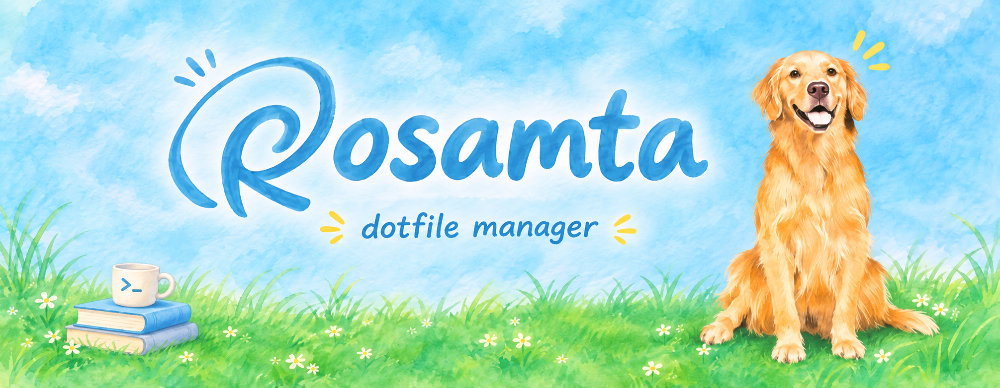

 

# rosamta (Agile + AI)

`rosamta` is a cross-platform dotfile manager. Settings shared by many programs (colors, fonts, shell environment) live in modules, and one module generates the config files for every program that uses it.

This repository is the **Agile + AI** team of the CS3025301 Software Engineering midterm project. It builds the same product as [rosamta-waterfall](https://github.com/accidental-two-timer-sam-woof/rosamta-waterfall) and [rosamta-agent](https://github.com/accidental-two-timer-sam-woof/rosamta-agent). The scope ends at requirements analysis and UML.

## How we work

- User stories and sprints are managed in GitHub Projects ([board](https://github.com/orgs/accidental-two-timer-sam-woof/projects/2))
- AI may propose user stories, acceptance criteria and story points. **Only the Product Owner accepts a story**, and the team decides the story points
- Every use of AI is recorded in [`docs/ai-log/`](docs/ai-log/)
- Every change goes through a pull request and needs at least one review. See [CONTRIBUTING.md](CONTRIBUTING.md)

## Team

| Member | Role | Responsibilities |
| --- | --- | --- |
| Stanley | Product Owner | Product vision, accepting stories, merging PRs, sprint review |
| Jonas | Scrum Master | Board upkeep, daily records, sprint planning and retrospective |
| SamWang | Design lead | UML diagrams, slides, demo |

Writing stories and keeping the AI usage log are shared by everyone.
