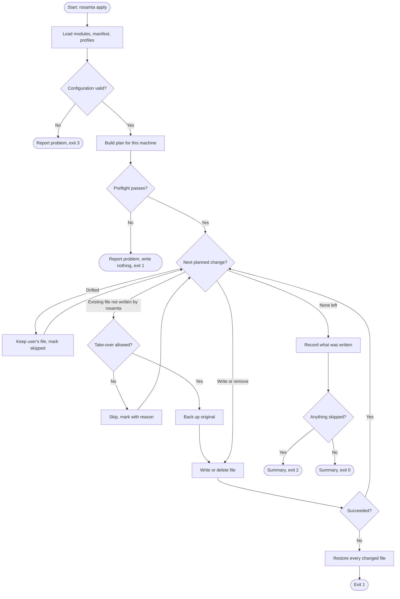

# Activity diagram: apply

The decisions apply makes for each output, and which exit code each path ends with (S20).

## Decision

A failed preflight writes nothing and exits with code 1. This was an open question from drawing this diagram, because S20 gave no code for it. Decided by Stanley (PO) at the start of Sprint 2 (2026-11-11). See `docs/decisions.md`.
