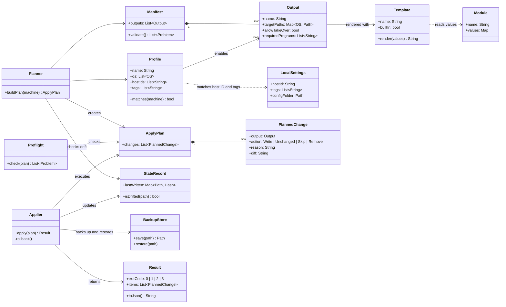

# Class diagram

Domain model for rosamta v1, from the accepted stories. Names are placeholders for the design, not final code names.

## Notes

- `StateRecord` stores only a hash of each written file, never its content, because outputs may contain secrets.
- `LocalSettings` lives on each machine and is not part of the shared config folder (S08, S18).
- `Profile.hostIds` uses a fixed Host ID instead of the system hostname (change request on S07, #12).
