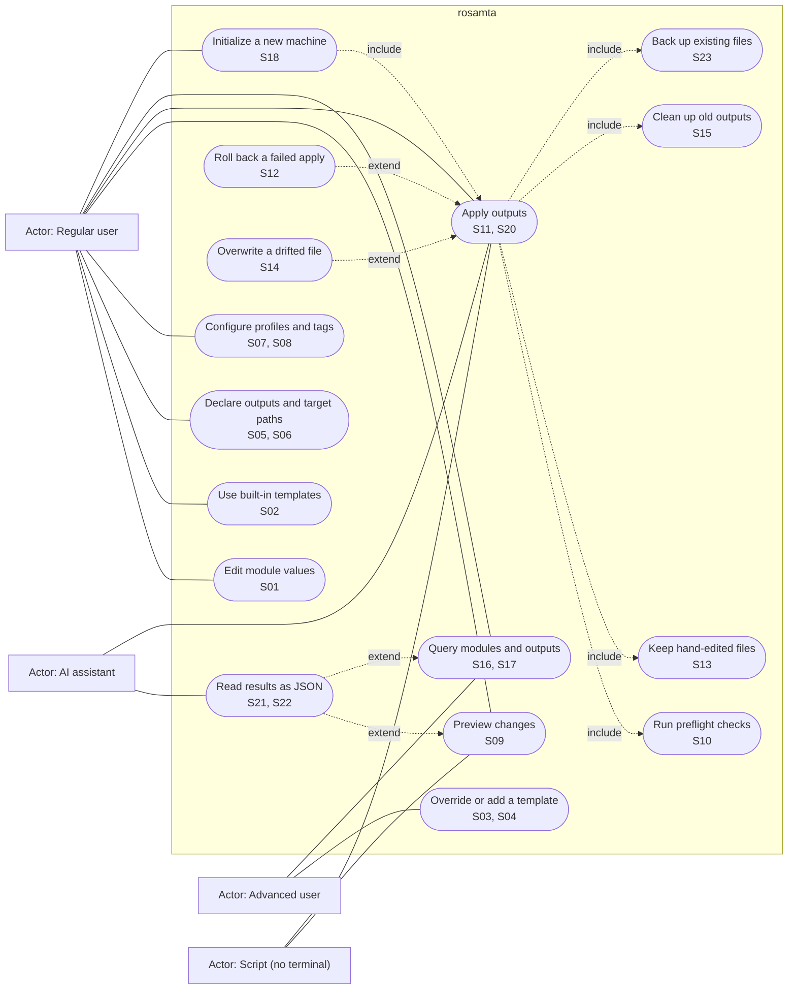

# Use case diagram

Actors and the main use cases of rosamta v1. Each use case lists the stories it comes from. Dotted arrows show `include` (always happens as part of the use case) and `extend` (happens only in some cases).

## Notes

- The script actor covers S19 (never wait for input) and S20 (exit codes): every use case it touches must run without prompts and report through exit codes.
- Use cases come from the accepted stories (#6 to #28). Use cases for Should and Could stories are included so the diagram shows the whole v1 scope.
